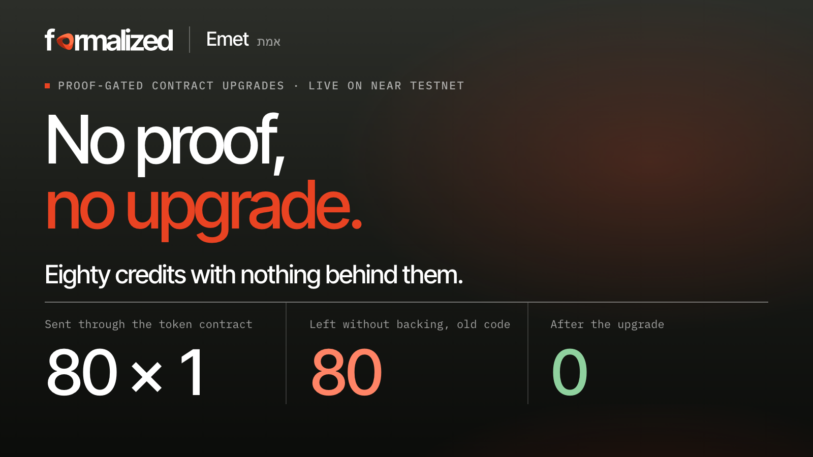
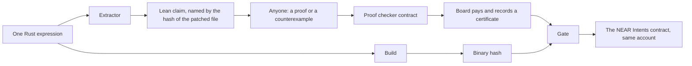

<div align="center">

# Emet

### No proof, no upgrade.

**A Lean proof checker inside a NEAR contract decides whether a contract can upgrade.**

[](https://github.com/formalized-si/emet/actions/workflows/ci.yml)
[](https://testnet.nearblocks.io/address/v2.emet.testnet)
[](cases/intents-refund/RefundCase.lean)
[](LICENSE)

**[Open the page](https://emet.formalized.si/) · [Watch the demonstration](https://emet.formalized.si/docs/assets/demo.mp4)**

[Try it](#try-it) · [On testnet](#what-happened-on-testnet) · [The rule](#the-rule) · [How it works](#how-it-works) · [Why NEAR](#why-near) · [FAQ](#faq) · [Documentation](#documentation)

<code>./verify.sh</code>

<br />



</div>

---

AI agents will write contract patches. Emet lets a contract take one only with a machine-checked proof. A Lean proof checker runs inside a NEAR contract. A second contract holds the only right to upgrade a third, and uses it only after the checker accepts a proof for the patch. Anyone can supply the proof, an AI agent included. Nobody can upgrade without it, us included.

Built for NEAR HACKATHON 2026 by [Mike Murunov](https://x.com/mike_genproof) and [Maksim Borisov](https://x.com/mbor1sov). The entry in the hackathon's project list is "No Proof, No Upgrade (Emet)". Tracks: AI Security & Defense, Agent Economy, Open Innovation.

Emet is live on NEAR testnet. The test subject is one line of NEAR Intents. In November 2025 one pull request ([#150](https://github.com/near/intents/pull/150)) added a comment, `refunds are capped by deposited amounts`, and an expression that did not cap them. The team's own regression test for the incident of 29 September to 1 October 2026 fails on that expression.

Here the comment is a Lean statement. The proof checker refutes the code that carried the comment. The gate installs the team's own fix only after the chain checks the proof of that fix. **Emet found none of this.** The NEAR Intents team found the cause, recovered the funds and fixed the contract. Their code is the test subject for a gate.

## Try it

| Do | See |
|---|---|
| Open [the page](https://emet.formalized.si/). Pick "The deployed code of 1 October" and press **Check this patch on NEAR**. | `Refuted`, with the inputs: the receiver asks for 100 back on a deposit of 1, and the patch returns 100. Your browser sent a counterexample to the proof checker contract, [`kernel.v2.emet.testnet`](https://testnet.nearblocks.io/address/kernel.v2.emet.testnet), as a read-only call. You need no wallet and no key. |
| Pick "The NEAR Intents team's own fix" and press again. | `Proved`, and the block at which the contract answered. |
| `./verify.sh` (Python 3 and nothing else, about a minute) | The offline checks of every recorded run, then 36 `PASS` lines that the script reads from testnet now, and `all checks passed: 35 read-only RPC calls`. The lines show four things. The binaries on the chain are the binaries in `artifacts/`, which `./verify.sh --lean` and `--refund` rebuild from the sources here. Five contracts have no access key. The gate installed the fix on a proof certificate. The checker accepts five real proofs and refuses four wrong ones. |
| `./verify.sh --rehearse` (Node 20+, about 4 minutes) | The whole story as real transactions on a fresh local node. The run ends with `18/18 checks passed.` |
| `npm ci`, then `node agent/claim.cjs --account <you>.testnet --key-file ~/.near-credentials/testnet/<you>.testnet.json` | The board pays your account 0.3 NEAR for each bounty that is still open on the testnet board. Two were open on 13 November 2026, and `./verify.sh --live` prints which. The account needs about 4 NEAR for the gas that the call reserves. Most of it comes back. |

## What happened on testnet

The deployment is 52 transactions of 13 November 2026. `emet.testnet`, [`v2.emet.testnet`](https://testnet.nearblocks.io/address/v2.emet.testnet) and its nine sub-accounts signed them. [deploy/testnet.json](deploy/testnet.json) lists each transaction with what it returned.

| Step | Transaction |
|---|---|
| Old code, 80 transfers of 1 through a token contract: the refund callback fails, and 80 credits stay with no token behind them | [`D9KnE7Mb…`](https://testnet.nearblocks.io/txns/6Z8vL3zyMeez2qvCM8Zgde1AwDMxSQ7qZhDrhEAF77jh) |
| The guardian pauses deposits | [`ADwDsTQX…`](https://testnet.nearblocks.io/txns/629p34LSNQEZ2rdiSLNe6k3B8fbXG51dnMkeWocmJKig) |
| A caller asks the gate to install the fix before any proof exists: the gate installs nothing | [`4JLxcsJM…`](https://testnet.nearblocks.io/txns/8gtRgk2vp1Lq2c8X1Qgd4WeDfAwq6MxrpaHjVqAh87ar) |
| A caller offers the gate a binary that differs in one bit: the gate refuses it | [`Do9h4zZE…`](https://testnet.nearblocks.io/txns/43pkLyLdrRE2LvF45b4bVKRoKNJAjH4fW4votfFQebMd) |
| A counterexample to the old expression: the proof checker accepts it, the board pays its author | [`8wtSSXif…`](https://testnet.nearblocks.io/txns/8hffZLs47Ms7mRpgZRx14Gw4t8AQj2T75nFyx3gUve4b) |
| A proof for the fix: the proof checker accepts it (137 TGas), the board pays its author | [`467a5gRZ…`](https://testnet.nearblocks.io/txns/GrpZSfrnVaxt5EGcbsXdacagFq3KjeimPPPrgYCtNSaf) |
| The gate reads the certificate and upgrades the contract | [`7eV5DGf7…`](https://testnet.nearblocks.io/txns/8QaELsm36m21ij3AW7QuZjcrB8dT4CqT3VCE2qLtucc1) |
| The same 80 transfers to the same account: the batch completes and adds no credit without backing | [`C1kyRcQP…`](https://testnet.nearblocks.io/txns/HREKnogCDfHWDW1Ksjf6AT9XJwGR9ufFgDhC8S1h75R3) |
| Later, the board pays an open bounty on a wrong patch for a counterexample that an open-weight model wrote | [`5MuqZxh8…`](https://testnet.nearblocks.io/txns/3cpPvWLdChwgP6yE95eMn63Lm6yknzeLwXXSpVGFqawy) |

The proof checker, the board, the gate, the upgraded contract and the token ledger have no access key. The gate used its one upgrade, and nobody can upgrade that contract again: no account holds a role that could grant the `Upgrader` right to a second gate. The test receiver, the guardian, the prover and the courier are ordinary accounts whose keys we hold. The explorer answers automated clients with a challenge page. For such a client, `python3 tools/check_live.py --tx` fetches all 52 transactions from an RPC node.

## Our first deployment was unsound

The deployment above is `v2`. There was a `v1`, and its checker was unsound. We are telling this plainly because it is the clearest thing the project demonstrates: the escape hatch worked, on a public chain, against our own contract.

nanoda computes a few functions, among them `Nat.gcd`, by their name: when it meets the constant `Nat.gcd` applied to two literals, it returns the built-in result and never reads the declaration behind the name. The sealed environment of `v1` did not declare `Nat.gcd`. So a proof file could declare `def Nat.gcd := fun _ _ => 0`, prove `∀ a b, Nat.gcd a b = 0` from that body, and then derive `False`, because the checker still computes `Nat.gcd 4 6` to `2`. A 2.7 kB file did it. On 13 November a review found this against the exact binary, `kernel.v1.emet.testnet`.

That contract has no access key, so it cannot be corrected. We did the honest thing instead: we claimed the bounty for a proof of `False` on `board.v1.emet.testnet` with that file. The board checked it, paid 1 NEAR, and set its own `kernel_broken_by`. `v1`'s board now records on chain that its checker is broken and pays nothing more. The record is [deploy/v1/false-claim.json](deploy/v1/false-claim.json), and `node deploy/claim-false.cjs` reads the live state.

The fix is a rule the contract already had for axioms, extended: a proof file may not declare any of the 31 names the checker computes by itself ([`BUILTIN_NAMES`](contracts/kernel/src/lib.rs)). Every environment we seal now also declares those names, so there is nothing for a file to shadow. `v2` runs the fixed checker (`nanoda_lib-0.4.32/pinned-base/v4`), and the two proofs are regression tests (`cheats/deltas/builtinGcd.delta.ndjson`, `builtinString.delta.ndjson`). This is our own extension, not nanoda's: nanoda documents that its literal extensions are trusted as axioms ([ammkrn/nanoda_lib#68](https://github.com/ammkrn/nanoda_lib/issues/68)), and the mistake was ours, in sealing an environment that left those names open to a stranger.

## The rule

The contract sizes the refund event when a deposit arrives. It assumes that a refund is never larger than the deposit. Its [own note](cases/intents-refund/upstream/tokens.rs#L217) says: *"The refund memo size was already accounted for in the original mint"*. A compiler cannot refuse a comment. Here the comment of November 2025 is the second line of a Lean statement ([RefundCase.lean](cases/intents-refund/RefundCase.lean)):

```lean
def Rule (a : Args) (r : Nat) : Prop :=
  r ≤ a.requested ∧  -- never more than the receiver asked to return
  r ≤ a.deposited ∧  -- upstream's comment: "refunds are capped by deposited amounts"
  r ≤ a.balance ∧    -- "and balance left on the receiver"
  (r = a.requested ∨ r = a.deposited ∨ r = a.balance)  -- and never less than the three allow
def meetsRule (e : Expr) : Prop := ∀ a : Args, InRange a → Rule a (eval a e)
```

A patch is another expression at the same place in the same file. Either it meets the rule for every input that fits in a `u128`, or some input breaks a line of it.

| Patch | Verdict of the proof checker | Counterexample (requested, deposited, balance) |
|---|---|---|
| `balance_left.min(requested_refund)`, the deployed code | refuted | (100, 1, 1001): returns 100, more than was deposited |
| `requested_refund.min(*deposited)` | refuted | (1, 1, 0): returns 1, more than the receiver holds |
| `(*deposited).min(balance_left)` | refuted | (1, 2, 2): returns 2, more than was requested |
| `0u128` | refuted | (100, 1, 1001): returns 0, less than the rule allows |
| `requested_refund.min(*deposited).min(balance_left)`, the team's own fix | proved | |

The rule is small, and we chose the case for that reason. The sentence was in the source, and nothing checked it. With that sentence as its rule, a gate refuses that code at the first attempt to install it. A gate does not write the rule. It also does not deploy the team's fix of March 2026 ([#240](https://github.com/near/intents/pull/240)) sooner.

A second theorem in the same sealed environment ties the rule to the property that failed: the size of the refund event. Its model gives the length of the log that testnet refused, 17,519 bytes, to the byte ([the log budget](docs/TECHNICAL.md#the-log-budget)).

## How it works



- **Proof checker** (the "kernel" contract). It is [nanoda](https://github.com/ammkrn/nanoda_lib) 0.4.32, an independent Lean 4 type checker, compiled to wasm. It type-checks a sealed environment once (534 declarations, no axioms). Then it checks each submitted proof against that environment inside one function call.
- **Board.** A bounty names a claim and its negation. The board pays the first proof of either that the checker accepts, and records it as a certificate. A prover commits to a hash first and reveals later, and the first accepted proof wins, not the first commitment. A copier must commit after it sees the proof and then wait the reveal delay, one block on the testnet board. The RPC node that carries your free check or your reveal sees the proof first and can win: check on your own node if that matters.
- **Gate.** Its deployer registers a fixed list of candidates: for each, the hash of the patched file, the binary hash, the claim and the bounty. The gate stores a binary only if every chunk matches its registered hash. It calls the contract's `upgrade` only if the board holds a *proof* certificate for the claim of that candidate. A paid counterexample authorizes nothing. One gate installs one upgrade.
- **The contract.** It is a build of the NEAR Intents team's commit, with the source unmodified.
- **In an emergency** the fast path is a pause. A guardian account, whose key we hold, has the contract's two pause roles. It can pause and unpause every feature a pause manager may stop, not deposits only, and only it can unpause. It cannot change the code.
- **If the checker itself is wrong.** A bounty of 1 NEAR for a proof of `False` is open on the same board. If someone claims it, the board records its proof checker as broken, and the gate starts no new installation. This is not a drill: on our first deployment the checker was unsound, and claiming this bounty is how we recorded it on chain. See [Our first deployment was unsound](#our-first-deployment-was-unsound).

Trusted, not proved:

- **The extractor.** It reads one expression site with a grammar of three inputs, literals, parentheses and `min`, and fails closed on anything else. We sampled it against rustc on 45 further expressions and did not verify it; a review found one form, `*deposited.min(x)`, that it read differently from rustc, and it now refuses that form.
- **Lean and lean4export.** They turn `RefundCase.lean` into the sealed environment. The checker sees that export, not the source text this page prints; `./verify.sh --lean` makes the export again and compares the bytes.
- **The Rust compiler, and the pairing of a patched file with a binary hash.** The deployer sets the pairing when it registers a candidate. The chain checks the proof and does not check that pairing. All seven Rust-built binaries here rebuild to the same bytes on macOS arm64 and Linux x86_64, so anyone can check the pairing.
- **The proof checker, the Rust code of the board and of the gate, and NEAR.** The checker also computes a few functions (`Nat.gcd` and others) and a few literal types by name; a sealed environment must declare every such name, and the contract refuses a proof file that declares one (see "Our first deployment was unsound").

**This is a proof about one expression. It is not a proof about the binary, the callback or the NEAR Intents contract.** The gate's deployer chooses the rule and the list of candidates. The gate cannot install a patch that nobody registered, whoever proves it. See the [technical reference](docs/TECHNICAL.md).

## Why NEAR

- **A proof check is one function call.** The fix's 13.9 kB proof costs 137 TGas, about 0.014 NEAR. A transaction can carry 1,000 TGas. A question to the checker is a free view call, and the page's button makes that call.
- **The gate needs no new mechanism.** It is the only holder of the contract's own `Upgrader` role, the access control NEAR Intents already uses. Each contract here deletes its access key in the transaction that deploys it.
- **The prover can be a model nobody trusts.** Open-weight models on NEAR AI Cloud wrote proofs for this checker. A key that NEAR AI's attested TEE reports signs each response.

## A model writes the proof, and is paid on testnet

One of the open bounties on the testnet board was on the patch `requested_refund.min(*deposited)`. That patch caps the refund by the deposit, as the old comment asked, and forgets the receiver's balance. DeepSeek V4.1 Flash is an open-weight model that [NEAR AI Cloud](https://cloud.near.ai) serves. The script told the model which side to take, that the patch is wrong and that small concrete values usually work. It gave the model the Lean definitions, and no values and no proof.

In 29 requests and 13 minutes the model found the values: requested 2, deposited 3, balance 1. For these inputs the patch returns 2, more than the balance left. The model wrote a proof of 5,095 bytes with no axiom. A courier script [committed](https://testnet.nearblocks.io/txns/777RRUW4Y1Ds673K4MAiNKYpm8BpxCp7TofXk45NokgZ) and [revealed](https://testnet.nearblocks.io/txns/3cpPvWLdChwgP6yE95eMn63Lm6yknzeLwXXSpVGFqawy) the proof. The proof checker contract checked it in 122 TGas, and the board paid 0.3 NEAR. The model run cost USD 0.085 at list price.

The certificate on the board names the hash of the proof file in this repository. `./verify.sh --live` checks that hash against the chain. Every response of the model carries a signature of NEAR AI's model service. `./verify.sh --nearai` checks those signatures with no API call.

The model holds no key. The account that the board paid is ours, and a script signed for it. See [the record](evidence/nearai-testnet/README.md).

On a local node three open-weight models got a harder task. Each model got the pinned source file, one observed transaction and the rule in words, with no fix and no Lean. Four of five attempts ended with a patch and a proof that the proof checker contract accepted. In each of the four, the gate installed the contract that we built from the model's own source ([the five attempts](docs/TECHNICAL.md#near-ai-evidence)).

## The same checker under an agent's wallet

The first thing that we built on this checker was a wallet for an AI agent. The wallet's spending rules are a Lean function, and we compile that function into the deployed wasm. The bounties are statements about every sequence of requests to that function. The wallet's first policy promised "at most 6 NEAR per day". On a local node an agent sent 11 NEAR through the wallet in four payments and 24 seconds, around the moment the window rolled over.

The board paid an AI agent for a Lean counterexample to the promise, and the transaction that paid the agent froze the wallet. An AI agent proved the corrected policy for every sequence of requests, and the same four payments stop at 6 NEAR. `./verify.sh --wallet` runs the 19 checks. `./verify.sh --faults` runs the 12 failure paths. This part runs on a local node only.

## A larger statement: NEAR Proof Arena's transfer relation

[NEAR Proof Arena](https://github.com/ilblackdragon/near-proof-arena) holds a Lean specification of how nearcore handles a batch of transfer receipts: `NearSpec.TransferV1.NearRelation`. The Arena proves two theorems about that relation. The relation determines its outputs. Whatever the relation holds for lies inside the specified domain. A second copy of the checker on testnet, [`arena2.emet.testnet`](https://testnet.nearblocks.io/address/arena2.emet.testnet), sealed that statement (1,600 declarations, 2.96 MB). Then it accepted each of the Arena's own proofs in one transaction: [395 TGas](https://testnet.nearblocks.io/txns/Dv8kVWa7nZSroH3mErZ4W9iFsDYhWVe7xVKWb6cAdWBx) and [393 TGas](https://testnet.nearblocks.io/txns/2GaHV3AXxNTsBuhpmSB6JJGPRNCJMWd8qw7ANNJraP8v).

We sent one of the two proofs under the other claim, and the checker [refused it](https://testnet.nearblocks.io/txns/4Eh39oeZMVNpbngkxd9nZE9ata1NFW3WBsaX3N26d2ee). We use the specification as it is, and we prove nothing about nearcore here. `./verify.sh --live` reads the state of that contract. `bash tools/measure_nearspec.sh` repeats the whole run on a local node in about 2 minutes.

## Run it

| Command | Needs | Time | Action |
|---|---|---|---|
| `./verify.sh` | Python 3 | about 1 min | Runs the offline checks of every recorded run, then `--live`: read-only questions to the testnet deployment |
| `./verify.sh --rehearse` | Node 20+ | about 4 min | Runs the refund story on a fresh local node: 18 checks |
| `./verify.sh --serve` | Node 20+ | under 1 min | Serves the page with a proof checker on a local node behind its button |
| `./verify.sh --wallet`, `--faults`, `--hostile` | Node 20+ | 5 to 12 min each | Runs the wallet scenario and its failure paths, and sends 98 forged or invalid proofs through the checker contract |
| `./verify.sh --refund`, `--lean`, `--nearai` | Rust 1.98.0 with wasm32, cargo-near 0.22.0, Lean 4.35.0 | 2 to 6 min each | Rebuilds both NEAR Intents commits and every binary from source and compares bytes. Derives the proofs again. Checks the models' signed responses again |

The local node runs on macOS arm64 and Linux x86_64. On Linux, if the host cannot run a mode and Docker is present, the mode runs itself again in a pinned container. [AGENTS.md](AGENTS.md) maps each statement of this page to a command and to the line to look for. To try a patch of your own, with your own proof or the built-in prover, see [docs/TECHNICAL.md](docs/TECHNICAL.md#your-own-patch).

We also sent 98 forged or invalid proofs through the checker contract on a local node. Most are the exports the [Lean Kernel Arena](https://arena.lean-lang.org) expects a checker to reject; the rest are our own, including the two of [Our first deployment was unsound](#our-first-deployment-was-unsound). The contract admitted none of them and accepted all 18 valid controls. The Arena's files test a checker on complete exports that Lean wrote; they do not test what a hostile proof file adds to a small sealed environment, which is where both of our own soundness bugs were. Each one is a regression test now.

## FAQ

**Did Emet find the NEAR Intents bug?** No. The NEAR Intents team found the cause, recovered the funds, fixed the contract and published a post-mortem. Emet uses two of their own commits as a test subject. The checker refutes the old expression. The gate installs their fix after the checker accepts its proof.

**Is the theorem only "the minimum of three numbers"?** For this case, yes, and we chose the case for that reason. The sentence was in the source as a comment, and nothing checked it. The same checker contract also accepted statements about every sequence of requests to an agent's wallet. It also accepted two theorems over NEAR Proof Arena's specification, an environment of 1,600 declarations.

**Who chooses the rule and the patches?** The deployer of the gate chooses them. The deployment fixes the rule, the list of candidate patches and the pairing of each patched source with a binary. Anyone can read all three. The chain checks the proof. The gate cannot install a patch that nobody registered, whoever proves it, and one gate installs one upgrade.

**What does a team gain if it gives its `Upgrader` role to a gate?** For a change with a rule that someone can write down, the gate replaces "trust whoever holds the key" with "check the proof". It also gives up three things, and we built the smallest version: the gate installs one binary from a list fixed at its deployment and then stops for good; the next fix has a path only if the installed build hands the role to a next gate, which we did not build; and any account may call the gate once the certificate exists, so the team does not pick the moment. The gate does not replace the fast path: a guardian keeps the right to pause and cannot change the code. We do not claim that a real team needs this today. The deployment shows that the mechanism works on real code, on a public network. The first step for a team would be small: one sentence its code already states in a comment, one expression, one upgrade.

**What does a check cost?** A check is one function call. The fix's 13.9 kB proof costs 137 TGas, about 0.014 NEAR, against an environment of 534 declarations. Against the 1,600 declarations of the Proof Arena statement a check costs about 395 TGas. Most of that gas reads the environment again, and little of it checks the proof. A check of up to 300 TGas also runs as a free view call.

**What if the proof checker is wrong?** Then it accepts a false statement, and that has happened twice here. On 11 November the pinned checker accepted two forged proofs of `False` from the Lean Kernel Arena; we updated nanoda to 0.4.32 the same day. On 13 November a review found a second, deeper hole, and our live first deployment had it: see [Our first deployment was unsound](#our-first-deployment-was-unsound).

A bounty for a proof of `False` is open on the testnet board until 12 December 2026 (a bounty here lasts 90 days at most). If someone claims it, the board records its proof checker as broken, and the gate starts no new installation; an installation already dispatched continues. The bounty catches only a finder who claims it: the same proof of `False` proves any claim on the board, and whoever claims it before the gate installs a fix also blocks that fix for good. An open bounty is not a proof of soundness. We proved that ourselves, by claiming it on the first deployment.

**Do the AI models act on the chain by themselves?** No. A model writes a patch or a proof as text. Scripts of this project send the transactions with keys that we hold. The models' responses carry signatures from NEAR AI's attested service. The signatures tie each text to NEAR AI's model-serving machine and to the model name in the request; they do not show which weights that machine loaded.

**Is it on mainnet?** No. Everything public is on NEAR testnet, and the wallet case runs on a local node only.

**Is this the EMET spending vault from the same hackathon?** No. [EMET](https://github.com/GreatSage-dev/emet) is the project of another team: a spending vault and an escrow for AI agents. The two projects share a name and no code. This project is the proof checker and the upgrade gate. Its entry in the hackathon's project list is "No Proof, No Upgrade (Emet)".

## What is next

- **Larger statements as free calls.** A check against the 1,600 declarations of the Proof Arena statement burns about 395 TGas, and about 325 of them parse the environment again. With the environment kept in the contract in parsed form, such a check fits the 300 TGas of a view call.
- **A gate for other contracts.** The gate calls the upgrade method of NEAR Intents. The next interface is `Upgradable` of near-plugins, with a walkthrough for a contract that is not ours.
- **More than one expression.** The extractor reads one Rust expression, and we sampled it against the compiler. The next statement is about the callback around that expression.
- **Mainnet.** The first step is the proof checker and the bounty for a proof of `False`, with real NEAR behind it.

## Repository layout

| Path | Contents |
|---|---|
| `contracts/` | The proof checker (`kernel`), the bounty board, the upgrade gate (`patch-gate`), and the wallet with its factory |
| `cases/intents-refund/` | The NEAR Intents case: the rule in Lean, the extractor, the proofs, the sealed environment, the builder of the two upstream commits |
| `cases/near-proof-arena/` | The two propositions over NEAR Proof Arena's transfer relation |
| `lean/`, `shelf/`, `proofs/`, `mutants/` | The wallet case: its policy in Lean, its sealed environment, the manifest of its proofs, four buggy wallets its claims catch |
| `cheats/`, `history/` | Invalid proofs, ours and the Lean Kernel Arena's, and the superseded checker binary that two of them fooled |
| `deploy/` | The scripts that ran on testnet and their records |
| `demo/` | The page (`demo/web`), the local scenarios, the recorder of the video |
| `agent/`, `skills/` | The courier that claims a bounty, the prover loops, and the protocol written for an agent |
| `tools/` | The checks behind `./verify.sh`, the builds, the measurements |
| `evidence/`, `artifacts/` | Records of runs, and the built binaries with their hashes |
| `docs/` | The technical reference and the notes it links |

## Documentation

- [AGENTS.md](AGENTS.md): every command, how long it takes, and the line that proves each statement on this page.
- [Technical reference](docs/TECHNICAL.md): the statement, the extractor, the gate, the board's lifecycle, the wallet case, the numbers.
- [Reproducible builds](docs/REPRODUCIBLE-BUILDS.md): why the binaries are the same on macOS and Linux.
- [The log budget](cases/intents-refund/LOG-BUDGET.md): what the second theorem says and does not say.
- [The protocol for an agent](skills/proof-courier/SKILL.md): commit, check for free, reveal.
- [Everything else](docs/README.md), [changelog](CHANGELOG.md).

Report a way to break the checker, the board or the gate through [SECURITY.md](SECURITY.md).

## What is not ours, and how this was written

- **The checker** is [nanoda_lib](https://github.com/ammkrn/nanoda_lib) 0.4.32 with a local patch. The patch adds a parser fast path, helper functions that the contract calls, and five lines in the inductive check ([PATCHES.md](contracts/kernel/PATCHES.md)).
- **The contract behind the gate** is [NEAR Intents](https://github.com/near/intents), unmodified, at two of its own commits. The first is [`35044fd`](https://github.com/near/intents/commit/35044fd1795b0de9d1ac269c6aa28a0d6a7efdfa), a temporary commit of the team ([#362](https://github.com/near/intents/pull/362)). With that commit the team put the deployed expression back, so that its regression test fails as production did. The second is its parent, `de07b1f`. `build.py` checks that the patched tree is the parent commit's tree, file for file. The refund issue and its fix are that team's work.
- **Libraries of other authors:** Lean 4.35.0 and its standard library, lean4export, near-sdk, near-plugins, near-api-js, near-workspaces and signal-exit. **Data of other authors:** the Lean Kernel Arena's test corpus and NEAR Proof Arena's specification. The scripts fetch NEAR Proof Arena's specification and do not keep it here. [THIRD_PARTY_NOTICES.md](THIRD_PARTY_NOTICES.md) lists the versions and the licenses.
- **Fonts and design of the page:** Inter Tight and IBM Plex Mono, under the SIL Open Font License. The page follows the design of [formalized.si](https://formalized.si), our own site.
- **Built with AI coding agents.** Mike Murunov and Maksim Borisov built Emet with Claude Code and Codex, and the agents wrote most of the code. Claude models and open-weight models on NEAR AI Cloud wrote the proofs for the wallet's bounties. No outside party audited any of it.

We wrote Emet for NEAR HACKATHON 2026, from 5 to 14 November. We carried the proof checker contract over from an earlier prototype of ours and reworked it here. We wrote that prototype after the hackathon's announcement of 19 October 2026, inside the window that the rules count. [CHANGELOG.md](CHANGELOG.md) lists the work by day. Internal identifiers still carry the working name Proof Courier.

Our organization built a second project for this hackathon: [Exit Proof](https://github.com/formalized-si/exit-proof). It answers a different question: can a depositor always withdraw from a NEAR contract? Exit Proof reads who can change the code of a contract and gives the contract an exit stage. It checks its Lean proofs off chain, and a registry on chain holds the certificate of an accepted attestor.

The two projects share no code. Both use Lean 4.35.0 and both study NEAR Intents: Emet takes one refund expression, and Exit Proof takes the token ledger. Each has an upgrade gate of its own. Exit Proof's gate asks a registry for a certificate. Emet's gate installs a patch only after the proof checker contract accepts the proof on chain.

## Contributing

Issues and pull requests are welcome. [CONTRIBUTING.md](CONTRIBUTING.md) has the setup, the checks to run before a change, and the few rules that keep those checks meaningful.

## License

The license is [MIT](LICENSE). Components that are not ours keep their own licenses, and [THIRD_PARTY_NOTICES.md](THIRD_PARTY_NOTICES.md) lists them.

*Emet (אמת) is Hebrew for truth. In the legend of the golem of Prague the figure lives while the word stands on its forehead. Erase one letter, and the rest reads "dead".*
