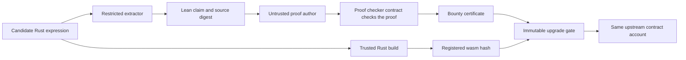

# Emet technical reference

Run commands from the repository root. The proof checker is the contract in `contracts/kernel`, and its code, accounts and binary carry the name kernel.

Two deployments run on NEAR testnet: the refund case (`deploy/testnet.json`) and the NEAR Proof Arena check (`deploy/testnet-arena.json`). `evidence/nearai-testnet/` records one more payment on testnet. Every other record here is from a local NEAR node. Nothing in this repository establishes a mainnet deployment or an external audit.

## A proof-gated upgrade of NEAR Intents code

`cases/intents-refund/` builds two commits of NEAR Intents and nothing of its own. The first is `35044fd1795b0de9d1ac269c6aa28a0d6a7efdfa`, "chore: TEMP change that reflects deployed state" (1 October 2026). It is a temporary commit on the branch of pull request [#362](https://github.com/near/intents/pull/362), "chore: reproduce bug". The commit puts the deployed refund expression `balance_left.min(requested_refund)` back on top of the main branch. With that expression the regression test of the pull request fails as production did. The team reverted the commit 26 minutes later, and it is on no branch.

The second commit is its parent, `de07b1f16f28af30778d02cae188710e30bd02fa`. It has the expression that the main branch carries since 23 March ([#240](https://github.com/near/intents/pull/240)): `requested_refund.min(*deposited).min(balance_left)`. The two trees differ in two lines of one file. `build.py` fetches both and checks that the patched tree is the parent's tree, file for file.

The team's response also limited batches to ten tokens ([#364](https://github.com/near/intents/pull/364)) and removed deposit notifications ([#374](https://github.com/near/intents/pull/374)). We model neither change. The issue is known and fixed. Emet did not find it.

The compiled contract reproduces two things.

1. A single deposit. The receiver gets a deposit of 1 and asks for 100 back. The old code answers 100, and the fixed code answers 1. On the old code the contract's own ledger then burns 100 of the receiver's credit, and nobody receives 100 tokens.
2. The shape of the regression test. Eighty transfers of 1 each ask for 10^35 back. They go through a second instance of the contract, which is the NEP-245 token ledger. On the old code the refund event exceeds the 16,384-byte log limit, and the `mt_resolve_deposit` callback fails. The ledger returns the tokens to the sender, and the receiver keeps 80 credits that no token backs. On the fixed code the batch completes and leaves no such credit.

The second result is the harm. The first result is its simplest symptom.

### The statement

```lean
def Rule (a : Args) (r : Nat) : Prop :=
  r ≤ a.requested ∧  -- never more than the receiver asked to return
  r ≤ a.deposited ∧  -- upstream's comment: "refunds are capped by deposited amounts"
  r ≤ a.balance ∧    -- "and balance left on the receiver"
  (r = a.requested ∨ r = a.deposited ∨ r = a.balance)  -- and never less than the three allow
def meetsRule (e : Expr) : Prop := ∀ a : Args, InRange a → Rule a (eval a e)
```

`InRange` bounds the three inputs to `u128`, so a counterexample must supply a witness that a Rust `u128` can hold. The four requirements leave one answer and no other: the smallest of the three amounts. `test_prepare.py` checks that equivalence in Lean.

We wrote the rule as four requirements for two reasons. A wrong patch then breaks a line that has a name. The second line is the assumption that the contract's log budget rests on. As mathematics the statement is a fact about `min`, and no more than that. A patch that returns zero for every input satisfies the three bounds and breaks the fourth line.

The claim of a candidate is `Refund.C_<sha256 of its patched file>.Correct`, and its negation is `.Refute`. The sealed environment of the five catalog candidates has 534 declarations and contains no axiom. `RefundCase.lean` proves three facts about `min` from the definition, because the library versions depend on `propext`. None of the five proofs uses an axiom. The fix's proof is 13,942 bytes, and each counterexample is about 16.8 kB. The record of a run has the gas for each (`gas_burnt_tgas` of the `reveal` transactions).

### The log budget

The second line of the rule is the assumption that the contract's log budget rests on. The contract checks the size of the refund event when the deposit arrives, and writes that event later without a check. `LogBudget.lean` models the two JSON lists that vary between the deposit event and the refund event. It proves two theorems in the sealed environment, without axioms. For any expression that meets the rule and any batch, the refund lists are not longer than the deposit lists (`refund_event_fits`). The old expression has no such bound (`old_refund_event_can_outgrow`).

`check_log_model.py` compares the model with the recorded events of the local runs and with the two batch transactions on testnet (`deploy/testnet-batches.json.gz`). The model gives each real length to the byte. The refund event that a local node refused has 17,353 bytes. The event that testnet refused has 17,519 bytes, because its account names are longer. [LOG-BUDGET.md](../cases/intents-refund/LOG-BUDGET.md) states what the model covers and what it does not cover.

### From Rust to the statement, and from source to binary

The extractor allows one expression site in the exact pinned file. Its grammar has the three `u128` inputs, unsigned literals, parentheses and `min`. It refuses other edits and other syntax. A generated probe compiled 45 further expressions with rustc and compared 2,700 inputs with the extractor's evaluation. It found no mismatch ([results](../evidence/refund-translation/results.json)). That is a sample and not a proof of the translation.

**We trust the extractor and its correspondence to Rust. We did not prove them.**



The builder makes a fresh archive of the pinned Git revision and changes the accepted expression. It disables inherited Rust wrapper settings. It hashes the whole source tree before and after the compilation. The registration step trusts that the operator pairs the right binary with the source. The gate cannot infer Rust semantics from a hash. [REPRODUCIBLE-BUILDS.md](REPRODUCIBLE-BUILDS.md) lists the binaries that rebuild to the same bytes, and the platforms.

### The gate

The gate stores an immutable candidate list: each entry names a source digest, a wasm digest, chunk digests, the exact Lean claim and a bounty. The gate checks chunks one by one, and the uploader of a chunk pays for its storage. Only a *proof* certificate authorizes installation. The certificate must be for the registered claim, on the registered environment, from a board that does not record its proof checker as broken. A paid counterexample authorizes nothing. The target has no keys and grants the gate its only `Upgrader` role.

Cross-contract reads are snapshots from earlier receipts. If the board marks the proof checker as broken after the gate read the board, a queued upgrade continues. A caller can reopen a stale checking phase with a new generation, so a late old callback cannot install code.

An uncertain upgrade keeps its candidate, because it is possible that the deployment succeeded before the migration failed. The gate retries only identical bytes under the original authorization. That policy fits this upstream migration, which does nothing. A migration that is not idempotent, or a recovery that someone can revoke, needs a different design. These recovery branches have Rust unit tests. The recorded runs exercise the successful path.

### On a network other people can read

`deploy/live-refund.cjs` runs the whole case with the committed binaries. It uses a local node by default and testnet with `--network testnet --send`. Both networks use one code path, in this order:

1. The proof checker and the environment, the board, two bounties and a standing bounty for a proof of `False`.
2. The gate, the contract with its role list, and a second instance of the contract as the token ledger.
3. The single deposit and the batch on the old code, then the guardian's pause.
4. An upgrade attempt without a proof, and a binary changed in one bit.
5. The paid counterexample, the paid proof, the upgrade, and the guardian's unpause.
6. The same deposit and batch again, and the access-key lists.

The script records every final transaction under its own label, so a second run after an interruption sends nothing twice. `--plan` prints accounts, funding and hashes and loads no key. `--open` leaves three more bounties open for anyone, and `agent/claim.cjs` claims them from any account. One transaction deploys each contract, initializes it and deletes its key, so the three steps happen together or not at all.

The script ran on testnet on 12 November 2026, from 11:26 to 11:33 UTC, under `v2.emet.testnet`. The run had 52 transactions in one pass, 0.46 NEAR of fees, and 16 of 16 checks. `deploy/testnet.json` is its record. The record has every transaction with its hash, signer, gas and returned value. It also has the two certificates, the role list of the upgraded contract, the access-key counts and the storage of each account.

A local rehearsal (`./verify.sh --rehearse`) prints 18 checks. The two more checks need an outside account. That account claims one open bounty with `agent/claim.cjs`, and the other open bounties stay open after the claim. On testnet we left the three open bounties for other people.

Later the same day the board paid one of them, bounty 3 on `requested_refund.min(*deposited)`, for a counterexample that an open-weight model wrote. DeepSeek V4.1 Flash on NEAR AI Cloud got the claim and the definitions through `agent/solve.py --backend nearai`. It produced a proof of 5,095 bytes with no axiom. `agent/courier.cjs` committed and revealed the proof from `courier.emet.testnet`, an account of this project. The receipt of the proof checker burnt 122 TGas. `evidence/nearai-testnet/claim.json` records the two transactions and the certificate, and `tools/check_live.py` compares that certificate on the chain with the proof file in this repository.

`tools/check_live.py` answers from the current state of the chain. It uses read-only queries and the Python standard library. It answers four questions:

- Is the code on the network the code in this repository?
- Does any access key exist?
- What do the board and the gate say?
- Does the proof checker, asked now, accept the five real proofs and refuse four wrong ones?

The four wrong ones are a counterexample offered as a proof, a proof offered for another claim, and two proofs with a swapped proof term.

```sh
node deploy/live-refund.cjs --plan           # accounts, funding, hashes; sends nothing
./verify.sh --rehearse                        # the whole run on a fresh local node (prepares Node packages and the node binary)
python3 tools/check_live.py                   # the recorded testnet deployment, read-only
./verify.sh --refund                          # rebuild from source and re-record locally
python3 cases/intents-refund/check.py         # saved evidence only
```

### Your own patch

`propose.py --candidate <complete-tokens.rs> --out <new-directory>` runs the same path for your own expression in a separate workspace. The workspace gets its own sealed environment, clean upstream builds and transaction records. The built-in prover supplies a proof or a counterexample. You can supply your own with `--proof Solution.lean`, and with `--side refutation` for the negation. The environment of a caller also admits `propext` and the library lemmas that depend on it, because simp-style proofs need them. Its certificate then lists that axiom.

The exporter refuses axiom, opaque and quotient declarations in a submitted delta before the script sends anything. Lean elaboration executes local code. It is not a sandbox for untrusted input.

## The wallet case: mechanism

A wallet developer publishes a decision function in Lean, its compiled wallet, a sealed environment and exact claims. A factory publishes the wallet bytes as a global contract and creates keyless wallets that use that hash. A bounty board pins the proof checker, the environment, the factory, the wallet code and the allowed claim pairs.

A prover commits a hash, checks its proof, waits for the reveal delay and submits the proof bytes. The proof checker checks the submitted theorem against the environment. The board accepts only the requested claim or its exact negation. It pays the first accepted answer and handles an optional escrow in separate receipts.

| Component | Responsibility | Trust boundary |
| --- | --- | --- |
| `contracts/kernel` | Parses the environment and the proof delta. Type-checks with nanoda. Reports the theorem, type hash, axioms and proof hash. | A bug in the checker can admit a false theorem. |
| `contracts/board` | Binds claims and commitments. Judges the proof checker's answer. Pays or refunds. Stops the funding of refuted code. | A Rust state machine with asynchronous receipts. We tested it and did not prove it. |
| `contracts/factory` | Publishes wallet code and attests which accounts it created from that code. | The factory code and the absence of keys bind wallets to the artifact. |
| `contracts/wallet` | Decodes calls, authenticates the caller, invokes the compiled Lean policy and schedules transfers. | The C adapter, the Lean compiler, the runtime and NEAR execution. |
| `agent` | Generates proof source and delivers exported bytes. | Nobody needs to trust the proof author: acceptance depends on the proof checker. Local Lean elaboration executes code and is not an OS sandbox. |

## Statements and assumptions

`lean/Policy/Bounties.lean` defines the claims. They quantify over policy parameters and request sequences, under their stated assumptions about the initial state and about time.

- `AllowedReceiversOnly`: accepted payments go to allowed receivers.
- `PerTxCapAlways`: an accepted payment does not exceed the per-payment cap.
- `NonceCountsPayments`: the nonce counts accepted decisions, not successful delivery of asynchronous transfers.
- `SlidingDayCap`: spending in an interval shorter than one day does not exceed the daily cap. This is false for v1.
- `SlidingTwiceCap`: the weaker v1 bound is twice the cap.
- `V2.SlidingDayCap`: the repaired policy satisfies the original spending bound.

The sliding-window claims require the initial state to be within its cap and request times to lie in the specified interval. A certificate does not prove that an arbitrary deployed contract implements these definitions. This project compiles the Lean decision function into its own wallet and binds factory wallets to the resulting code hash.

V2 preserves prior spending when a window rolls. It is conservative. Successful requests, zero-value requests included, can move the anchor again and again and carry the spending with it. `lean/Policy/Examples.lean` checks a trace that still refuses spending after three windows. The spending theorem is not an availability theorem.

## Proof and payment lifecycle

1. `post_bounty` fixes the claim pair, the statement hashes, the reward, the deadline, and the optional subject and escrow. The proof checker supplies the statements, and the factory attests the subject. If validation fails, the reward and the escrow return through paths that the caller can retry. The posting fee stays and pays for storage.
2. `commit` stores a domain-separated hash that binds the bounty id, the account, the side, the proof hash and the salt. The courier commits **before** it sends the proof to an RPC node for a free check.
3. `reveal` consumes the commitment after the delay, attaches a bond, and calls the proof checker. A bad proof forfeits its bond. A valid late proof gets its bond back.
4. `on_verdict` applies the result only to its matching pending proof hash. The first valid result records a certificate. The reward and optional escrow then move through separate receipts and callbacks.
5. A failed delivery of a reward or an escrow leaves an obligation that the caller can retry. Boosters withdraw their own part if an unanswered bounty expires. `clear_stale` is time-based and cannot establish why a callback did not complete.

Normal wallet payments invoke the compiled policy. A payment does not carry a new Lean proof. A proof authorizes the board's funding gate and establishes a property of the decision function.

## Counterexample and proof checker failure

An accepted counterexample marks that board's wallet code as refuted. The board stops new proof-gated funding and schedules a freeze of the bounty's subject. Anyone can ask the board to freeze another wallet that the same factory attests. A frozen wallet refuses agent payments. Its owner can withdraw to the owner's own account.

A one-sided bounty for a theorem of type `False` exercises the checker itself. If the board accepts such a proof, that board records its proof checker as broken. It stops new proof activity and funding, and it lets unanswered rewards and escrows return. This does **not** invalidate other boards that pin the same proof checker. An unclaimed bounty is not proof that the proof checker is sound.

**A freeze is one receipt for each wallet.** It takes effect when the wallet executes its freeze receipt, and not in all wallets at the moment the board accepts a counterexample. A freeze can fail, and a caller can retry it. Nobody can undo a transfer that the wallet scheduled before the freeze. A deferred funding callback checks the board's failure flags again before it schedules a transfer. Without that check, a request that began before a counterexample funds the wallet after it.

The regression tests in `contracts/board` reproduce that last case. Before the fix, both invalidated cases scheduled a transfer to `bob.wallets.near`. After the fix, both schedule the deposit back to `sender.near`, and a healthy board still funds the wallet. A pending posting callback also returns its reward if the board marked the proof checker as broken.

## What this does not prove

- We trust the compiler, the C adapter, near-sdk, nanoda and the NEAR runtime.
- The accounting of the board and the factory, the delivery of a freeze and the recovery of a refund are tested state machines. No machine-checked proof covers the full Rust programs.
- A correct theorem can describe the wrong intended policy. Someone must review the statement and its assumptions.
- Some transfer paths have no retry, and that is a documented limit of the implementation. A late or rejected bond refund, a stale-check refund or a direct funding transfer can fail if its recipient account is gone.
- Nobody can patch a keyless proof checker in place. An update requires a new deployment and a deliberate migration. We claim no automatic halt across the ecosystem.
- For the wallet policy, [RESIDUALS.md](../lean/Policy/RESIDUALS.md) lists each item that the proofs leave unproved.
- The local prover runs Lean source. Treat source elaboration as code execution. The path checks of the file tool are not an OS sandbox. The on-chain checker receives exported data and no Lean metaprograms.

## Numbers

The demo reads amounts, gas and outcome counts from [scenario.json](../evidence/demo/scenario.json). It keeps no second set of hand-written figures. It uses a wallet environment of 623 declarations, about 1.09 MB before compression. In the recorded run each accepted check fits in one NEAR function call. Heavy tactic proofs can exceed the budget.

A larger environment has a parsing cost for each check. `tools/measure_nearspec.sh` takes the transfer relation of [NEAR Proof Arena](https://github.com/ilblackdragon/near-proof-arena)'s specification of nearcore, `NearSpec.TransferV1.NearRelation`, at a pinned commit. It adds two propositions that restate theorems that the specification proves about the relation (`cases/near-proof-arena/EmetArena.lean`: `NearRelation.outputs_unique` and `NearRelation.domain`). The environment has 1,600 declarations and 2.96 MB. It holds Lean's three standard axioms, because the definitions of the specification use them.

On a local node the proof checker sealed the environment in 16 calls (4,313 TGas). It accepted each of the Arena's own proofs in one call, for 395 and 393 TGas. Of that gas, about 325 TGas parse the environment again, and 44 read it from storage. The type checking itself takes 3.1 and 2.4 TGas. The total is above the 300 TGas of a view call, so such a check is a transaction and not a free call. The proof checker refused the proof of one theorem under the other claim (`statement_mismatch`), and the record is in [evidence/nearspec](../evidence/nearspec/).

`deploy/live-arena.cjs` did the same on testnet on 12 November 2026. `arena2.emet.testnet` is a second proof checker with no access key. It sealed the environment in 21 transactions and accepted the two proofs for [395](https://testnet.nearblocks.io/txns/Dv8kVWa7nZSroH3mErZ4W9iFsDYhWVe7xVKWb6cAdWBx) and [393](https://testnet.nearblocks.io/txns/2GaHV3AXxNTsBuhpmSB6JJGPRNCJMWd8qw7ANNJraP8v) TGas. The record is `deploy/testnet-arena.json`. `tools/check_live.py` reads the state of that contract. With `--tx` it also reads the three transactions and the proof bytes that they carried.

We use the specification as it is. This is not an integration with NEAR Proof Arena, and we prove nothing about nearcore. The rejected experiment with heavy tactic proofs is in [evidence/shelf-measurements](../evidence/shelf-measurements/).

## Reproduce and inspect

```sh
./verify.sh --serve    # local preview and live kernel view checks
./verify.sh --offline  # hashes and consistency of saved evidence, no execution
./verify.sh           # the offline checks, then the read-only checks of the testnet deployment; lists the other modes
./verify.sh --wallet  # fresh local node, complete wallet/proof/payment scenario
./verify.sh --faults  # failure and retry scenarios, kernel regressions
./verify.sh --lean    # Lean, native kernel and byte comparison of rebuilt wasm
tools/check_arena.sh  # Lean Kernel Arena fixtures through the kernel built natively (the --lean toolchain)
./verify.sh --hostile  # full pinned hostile corpus through the kernel contract
./verify.sh --nearai  # saved NEAR AI proofs and attestation, no paid model requests
./verify.sh --rehearse # the refund case's public deployment, rehearsed on a local node
./verify.sh --live     # read-only questions to the deployment recorded in deploy/testnet.json
node --test demo/web/evidence.test.mjs
node tools/check_preview.cjs http://127.0.0.1:8798  # while --serve is running
```

`--lean` requires the documented toolchain. If the toolchain is missing, the command names the missing part, or on Linux with Docker it runs in the pinned container. Run the native Rust unit tests with `cd contracts/board && cargo test --release --locked`. Each build uses the pinned toolchain of its crate if you run it from the crate's directory.

The offline checker compares the recorded runs with the checked-in binaries. It does not execute those binaries and does not establish their correctness. The modes with a local node execute them. Seven binaries come from Rust: the proof checker, the board, the factory, the gate, and the three from the NEAR Intents commits. They rebuild to the same bytes on macOS arm64 and Linux x86_64. [REPRODUCIBLE-BUILDS.md](REPRODUCIBLE-BUILDS.md) explains the method and lists the hashes from both machines.

The two wallet binaries embed the platform string of the Lean toolchain. They reproduce only on the platform that built them (macOS arm64).

## NEAR AI evidence

There are three records. In each record the prover is an open-weight model that NEAR AI Cloud serves. `./verify.sh --nearai` checks each record again with no API call. It checks four things:

- NEAR AI's attestation report.
- The signature on every response.
- That `Solution.lean` is the last file that the model wrote.
- That nanoda accepts the proof, and that Lean, if present on the host, accepts the source and exports the same bytes.

**A counterexample paid on testnet** (`evidence/nearai-testnet/`). DeepSeek V4.1 Flash got the name of a claim and the Lean definitions. It found a counterexample to `requested_refund.min(*deposited)`, and the testnet board paid bounty 3 for it. The details are under "On a network other people can read" above and in [the record](../evidence/nearai-testnet/README.md).

**A patch and its proof, on a local node** (`evidence/nearai-refund/`, `agent/nearai_patch.py`). Three models each got the pinned NEAR Intents file, one observed transaction and the rule in words. They got no fix and no Lean. Each model had to propose a replacement for the expression. It also had to write a Lean proof of the claim that the scripts generated for its own patch, in three rounds at most.

| Model | Patch it proposed | Its proof | Axioms | Gas in the proof checker |
|---|---|---|---|---|
| DeepSeek-V4.1-Flash-1017 | `(requested_refund.min(*deposited)).min(balance_left)` | accepted in round 1 | none | 159 TGas |
| Qwen3.8-27B | `requested_refund.min(*deposited).min(balance_left)` | accepted in round 2 | none | 162 TGas |
| glm-5.3-flash | `balance_left.min(requested_refund).min(*deposited)` | none: stopped at the time limit of 1800 s | | |
| DeepSeek-V4.1-Flash-1017, asked to use no axiom | `requested_refund.min(*deposited).min(balance_left)` | accepted in round 1 | none | 160 TGas |
| glm-5.3-flash | `balance_left.min(requested_refund).min(*deposited)` | accepted in round 2 | `propext` | 159 TGas |

Four of five attempts ended with a proof that the proof checker accepted. For each of the four, the whole job ran on a fresh local NEAR node. The board paid the account that submitted the proof, and the gate installed the contract that we built from the model's own source. The scripts sent 19 requests. The service answered 17 and signed each answer. The cost was USD 0.10 at list price.

The scope of these five attempts is narrow. The rule in words almost gives the expression away, and the team published the fix in March. So the part that a model had to produce is the proof. A script signed the transactions, and the model signed none. [FACTS.md](../evidence/nearai-refund/FACTS.md) has the prompt, every request and response, and what the record does not show.

**The wallet's bounties, on a local node** (`evidence/nearai/`, `agent/solve.py --backend nearai`). The same three models took the wallet's open bounties with the prompt and the workspace that the Claude agents got. 5 of 16 attempts ended with a proof that the proof checker accepted. Among them is a counterexample to the daily limit from each model. `agent/nearai_local.cjs` replays the delivery. [SUMMARY.md](../evidence/nearai/SUMMARY.md) has every attempt.

`tools/verify_nearai.py` checks the saved response signatures and their link to the attestation. It compares `Solution.lean` with the signed `write_solution` response. If someone alters the response bytes or the source, the check fails. This script does not validate GPU evidence, or the freshness and revocation of Intel collateral. An attestation identifies a signed response. Lean and nanoda decide whether its theorem checks.

## Reviews

No outside party audited this. The reviews were separate AI sessions (Claude, Codex). Each session got the repository and the task to break it. We fixed each of their findings and added a regression test for it:

- a double escrow payment through a retry
- a claim tied to the wrong wallet code
- a freed claim name
- refunds that the board failed to deliver
- a verdict applied to a stale proof
- funding sent after a board marked its proof checker as broken

During the hackathon the Lean Kernel Arena published two forged proofs of `False`, and the proof checker version that we pinned accepted them. We updated it to nanoda 0.4.32, and both proofs are now regression tests ([contracts/kernel/PATCHES.md](../contracts/kernel/PATCHES.md)). A further review on 12 November led to the present wording of the README. It also led to the token-ledger batch, the pause and the bounty on `False` in the live run.

## Deployment

```sh
node deploy/live-refund.cjs --plan --network testnet --open   # the refund case
```

The command prints code and environment hashes, account allocations and the root funding. It loads no key, creates no account, and supports `sandbox` and `testnet` only. With `--open` the refund case needs 73.7 NEAR at the start. On testnet the run left 64.4 NEAR in the five accounts that end with no keys: proof checker, board, gate, upgraded contract and ledger. Their 6.0 MB of storage locks 59.9 NEAR of that amount, and nobody can take it back. `--sweep` returns what the prover, the issuer and the root still hold at the end.
